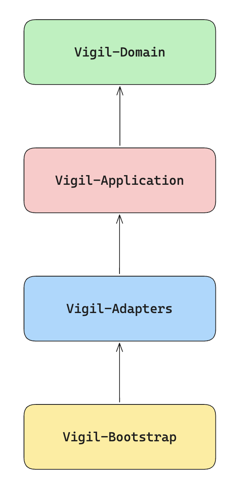
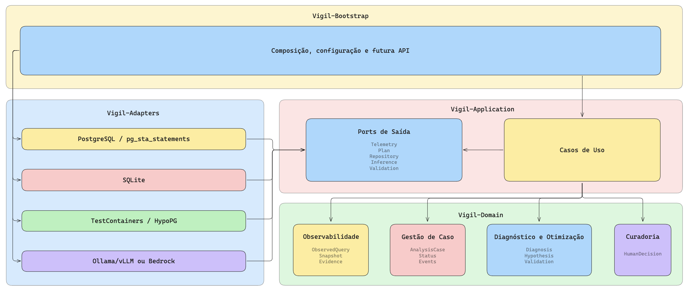

# ADR-003 - Monolito Modular com arquitetura Hexagonal

- **Status:** Aguardando aprovação
- **Data:** 2026-08-26
- **Decisores:** João Victor Fernandes Lima, 
- **Relacionados:** ADR-001 e ADR-002

## Contexto

O Vigil precisa evoluir incrementalmente, mantendo separação entre regras de negócio, casos de uso e integrações externas.
O sistema terá dependências de infraestrutura que podem variar ao longo do tempo:
- PostgreSQL e `pg_stat_statements`;
- SQLite;
- Testcontainers e HypoPG;
- Modelos locais via Ollama/vLLM;
- Provedores externos, como Amazon Bedrock;
- API Rest e interface de curadoria;

Essas tecnologias não podem definir as regras centrais do Vigil. Em especial, o domínio não deve depender de Spring Boot, JDBC, SQLite, Docker, SDKs de IA ou formatos específicos de APIs.

## Decisão

O Vigil será implementado inicialmente como um **monolito modular**, organizando segundo os princípios da **arquitetura hexagonal**.
O sistema será distribuído como uma única aplicação, mas seu código será separado em módulos Mavencom dependências unidirecionais:

## Módulos Técnicos

| Módulo              | Responsabilidade                                                                                          | Dependências permitidas                                              |
|---------------------|-----------------------------------------------------------------------------------------------------------|----------------------------------------------------------------------|
| `vigil-domain`      | Regras de negócio, entidades, value objects, máquina de estados e eventos auditáveis.                     | Apenas Java padrão e bibliotecas estrtiamente necessárias ao domínio |
| `vigil-application` | Casos de uso, orquestração e definição de ports.                                                          | `vigil-domain`                                                       |
| `vigil-adapters`    | Implementações de ports: SQLite, PostgreSQL, Testcontainers, modelos de inferência e integrações externas | `vigil-application` e `vigil-domain` transitivamente                 |
| `vigil-bootstrap`   | Composição de dependências, configuração, inicialização e futura API Spring Boot                          | Todos os módulos anteriores.                                         |

## Regras de Dependência
- `vigil-domain` não depende de nenhum outro módulo do Vigil
- `vigil-application` não depende de adapters ou bootstrap
- `vigil-adapters` implementa interfaces definidas em `vigil-application`
- `vigil-bootstrap` é o único módulo autorizado a conhecer a composição concreta da aplicação.
- Spring Boot permanece restrito a `vigil-bootstrap`
- Não será criado um módulo genérico `shared` ou `common`; código compartilhado deve pertencer a um contexto específico ou ser reavaliado.

## Arquitetura Hexagonal
Os casos de uso em `vigil-application` são o centro da aplicação.
Eles recebem comandos por ports de entrada e dependem de ports de saída para acessar recursos externos.

Exemplos de ports de saída:
- QueryTelemetryPort;
- QueryPlanPort;
- AnalysiscaseRepository;
- InferencePort;
- ValidationPort;

Implementações concretas desses ports pertencem a `vigil-adapters`

## Bounded Contexts iniciais
Os bounded contexts definem fronteiras de linguagem e responsabilidade do domínio. Eles não são módulos Maven adicionais neste momento;
são organizados como packages dentro de `vigil-domain` e `vigil-application`.

| Contexto                 | Responsabilidade                                                             | Conceitos principais                                                          | 
|--------------------------|------------------------------------------------------------------------------|-------------------------------------------------------------------------------|
| Observabilidade          | Representar consultas, telemetria, snapshots, planos e evidências observadas | `ObservedQuery`, `QuerySnapshot`, `QueryPlan`, `Evidence`, `Fingerprint`      |
| Gestão de Caso           | Controlar ciclo de vida, transições, eventos e rastreabilidade da análise    | `AnalysisCase`, `CaseStatus`, `CaseEvent`, `TransitionMetadata`               |
| Diagnóstico e Otimização | Sanitizar contexto, interpretar evidências, propor e validar hipóteses.      | `SanitizedContext`, `Diagnosis`, `OptimizationHypothesis`, `ValidationResult` |
| Curadoria                | Registrar a decisão humana sobre uma recomendação validada                   | `HumanDecision`, `APPROVED`, `REJECTED`, `CHANGES_REQUESTED`                  |

## Consequências

### Positivas
- Regras do Vigil podem ser testadas sem banco, Docker, Spring ou Modelo de IA
- SQLite pode ser substituído futuramente sem reescrever o domínio
- Ollama/vLLM e Bedrock podem coexistir como implementações diferentees de `InferecePort`.
- O vertical slice pode começar com adapters falsos e evoluir para integrações reais.
- A aplicação continua simples de executar e distribuir como uma única imagem Docker.
- A arquitetura oferece base para futura evolução multi-target, sem antecipar essa complexidade no MVP.

### Negativas
- Há mais módulos e interfaces do que em uma aplicação monolítica sem separação interna
- A criação de ports exige disciplina para não abstrair prematuramente
- O bootstrap pode concentrar configuração ao integrar muitos adapters
- Será necessário manter testes arquiteturais para impedir dependências invertidas.

## Alternativas Consideradas

#### Aplicação Spring Boot única sem módulos internos
Rejeitada porque acoplaria regras de negócio a Spring, JDBC e providers de IA desde o início

#### Microservices
Rejeitada porque adicionaria rede, deploy, observabilidade distribuída, autenticação e consistência entre serviços antes de validar o problema principal do Vigil

#### Arquitetura em camadas tradicional
Rejeitada como estrutura principal porque tende a permitir que infraestrutura atravesse as camadas e alcance o domínio. A arquitetura hexagonal torna os limites das integrações explícitos por meio de ports.

## Critérios de Conformidade
- Um teste em `vigil-domain` não pode exigir Spring, banco, rede ou Docker.
- Um caso de uso em `vigil-application` não pode importar classes de `vigil-adapters`.
- Nenhum adapter pode alterar diretamente o estado interno de `AnalysisCase`.
- Toda integração externa deve ser acessada por um port definido pela aplicação.
- O `vigil-bootstrap` deve apenas compor dependências; não deve conter regras de negócio.

