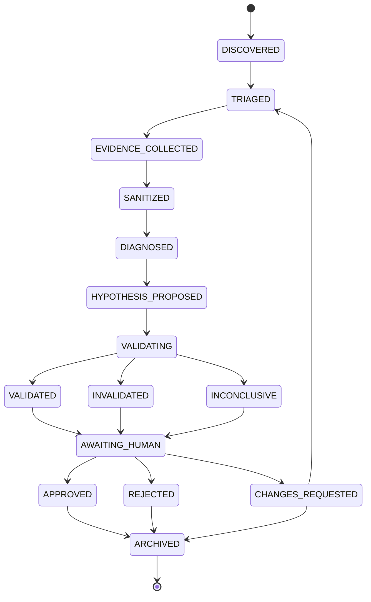

# Máquina de Estados - AnalysisCase

## Status

Proposto

## Objetivo

Definir o ciclo de vida de um AnalysisCase, seus estados, transições, artefatos obrigatórios e regras de auditoria. 
Este documento descreve o destino arquitetural do domínio.

## Princíprio central

Um estado não representa uma tarefa em andamento de um desenvolvedor.

Um estado representa um fato aceito e auditável sobre o AnalysisCase.

Exemplo:
- `EVIDENCE_COLLECTED` significa que o caso possui evidências mínimas válidas;
- `DIAGNOSED` significa que existe um Diagnosis fundamentado;
- `VALIDATED` significa que uma hipótese teve resultado favorável no Sandbox;
- `APPROVED` significa que uma pessoa aprovou uma Recommendation.

Nenhum estado autoriza o Vigil a alterar target monitorado.

## Estados

| Estado                | Significado                                                                                 |
|-----------------------|---------------------------------------------------------------------------------------------|
| `DISCOVERED`          | Uma candidate elegível originou um novo caso. Ainda não há decisão de iniciar investigação. |
| `TRIAGED`             | O caso foi aceito para investigação e possui uma razão de triagem registrada.               |
| `EVIDENCE_COLLECTED`  | As evidências mínimas necessárias para diagnóstico foram coletadas e verificadas.           |
| `SANITIZED`           | O contexto derivado das evidências foi sanitizado e possui política explícita de uso.       |
| `DIAGNOSED`           | Há um diagnóstico estruturado, limitado e fundamentado em evidências reais do caso.         |
| `HYPOTHESIS_PROPOSED` | Existe ao menos uma hipótese de otimização estruturada e testável.                          |
| `VALIDATING`          | Uma hipótese está sendo avaliada em Sandbox isolado.                                        |
| `VALIDATED`           | A hipótese demonstrou benefício estimado dentro dos critérios de validação.                 |
| `INVALIDATED`         | A hipótese não demonstrou benefício ou não se sustentou no Sandbox.                         |
| `INCONCLUSIVE`        | Não foi possível concluir a validação com segurança.                                        |
| `AWAITING_HUMAN`      | Uma Recommendation foi preparada e aguarda curadoria humana.                                |
| `APPROVED`            | Uma pessoa responsável aprovou a Recommendation. Nenhuma alteração é aplicada pelo Vigil.   |
| `REJECTED`            | Uma pessoa responsável rejeitou a Recommendation.                                           |
| `CHANGES_REQUESTED`   | A curadoria solicitou complementação, nova evidência ou nova hipótese.                      |
| `ARCHIVED`            | O caso foi encerrado e preservado para auditoria.                                           |

## Fluxo principal



## Artefatos obrigatórios por transição

| Origem                | Destino               | Comando de domínio      | Artefato obrigatório                                         | Regra                                                                   |
|-----------------------|-----------------------|-------------------------|--------------------------------------------------------------|-------------------------------------------------------------------------|
| -                     | `DISCOVERED`          | `discover`              | `Candidate`,<br/>`ImpactAssessment`,<br/>`ObservationWindow` | A Candidate deve possuir impacto suficiente segundo a política vigente. |
| `DISCOVERED`          | `TRIAGED`             | `triage`                | `TransitionMetadata` e razão de triagem                      | Não é permitido iniciar investigação sem motivo auditável.              |
| `TRIAGED`             | `EVIDENCE_COLLECTED`  | `collectEvidence`       | `EvidenceBundle`                                             | O conjunto deve atender a definição de evidência mínima.                |
| `EVIDENCE_COLLECTED`  | `SANITIZED`           | `sanitize`              | `SanitizationResult` e `SanitizedContext`                    | Contexto bloqueado não pode avançar.                                    |
| `SANITIZED`           | `DIAGNOSED`           | `diagnose`              | `Diagnosis`                                                  | Diagnosis deve referenciar Evidence existente.                          |
| `DIAGNOSED`           | `HYPOTHESIS_PROPOSED` | `proposedHypothesis`    | `OptimizationHypothesis`                                     | Hipótese deve ser estruturada, limitada e testável.                     |
| `HYPOTHESIS_PROPOSED` | `VALIDATING`          | `startValidation`       | `ValidationRequest` e `SandboxProfile`                       | Sandbox não pode usar endpoint ou credencial do target.                 |
| `VALIDATING`          | `VALIDATED`           | `recordValidation`      | `ValidationResult` com resultado `VALIDATED`                 | Benefício precisa satisfazer a `ValidationPolicy`                       |
| `VALIDATING`          | `INVALIDATED`         | `recordValidation`      | `ValidationResult` com resultado `INVALIDATED`               | A hipótese foi avaliada, mas não demonstrou benefício suficiente.       |
| `VALIDATING`          | `INCONCLUSIVE`        | `recordValidation`      | `ValidationResult` com resultado `INCONCLUSIVE`              | Não houve informação suficiente para uma conclusão segura.              |
| `VALIDATED`           | `AWAITING_HUMAN`      | `prepareRecommendation` | `Recommendation`                                             | Recomendação deve incluir hipótese, validação, evidências e limitações. |
| `INVALIDATED`         | `AWAITING_HUMAN`      | `prepareRecommendation` | `Recommendation`                                             | A recomendação pode informar que não é indicada uma alteração.          |
| `INCONCLUSIVE`        | `AWAITING_HUMAN`      | `prepareRecommendation` | `Recommendation`                                             | As limitações devem estar explícitas.                                   |
| `AWAITING_HUMAN`      | `APPROVED`            | `approve`               | `HumanDecision`                                              | Apenas ator humano autorizado pode aprovar.                             |
| `AWAITING_HUMAN`      | `REJECTED`            | `reject`                | `HumanDecision`                                              | Apenas ator humano humano autorizado pode rejeitar.                     |
| `AWAITING_HUMAN`      | `CHANGES_REQUESTED`   | `requestChanges`        | `HumanDecision`                                              | Deve indicar quais complementações são necessárias.                     |
| `CHANGES_REQUESTED`   | `TRIAGED`             | `retriage`              | `TransitionMetadata`                                         | O caso é reaberto para nova investigação, preservando todo o histórico. |
| `APPROVED`            | `ARCHIVED`            | `archive`               | `ClosureMetadata`                                            | A aprovação é preservada; o Vigil não exectura a alteração aprovada.    |
| `REJECTED`            | `ARCHIVED`            | `archive`               | `ClosureMetadata`                                            | O motivo da rejeição permanece auditável.                               |
| `CHANGES_REQUESTED`   | `ARCHIVED`            | `archive`               | `ClosureMetadata`                                            | Permitido quando a curadoria decide não continuar a investigação.       |

## Evidência mínima para diagnóstico

Um caso somente pode atingir `EVIDENCE_COLLECTED` se possuir, no mínimo:
1. Uma `ObservationWindow` válida, calculada por delta entre snapshots;
2. Uma `ImpactAssessment` explicando por que a Candidate merece investigação;
3. Um `QueryPlan` obtido com `EXPLAIN (FORMAT JSON)` sem `ANALYZE` no target;
4. `RelationMetadata` para as relações relevantes;
5. Metadados de índices existentes nas relações relevantes;
6. Otigem, instante de coleta e versão da política aplicada a cada Evidence.

O caso somente pode atingir `DIAGNOSED` se, alkém das evidências acima, possuir:
1. `SanitizationResult` permitido;
2. `SanitizedContext`;
3. `Diagnosis` com referências explícitas aos identificadores das evidências;
4. Limitações e nível de confiança registrados no Diagnosis.

## Regras de SanitizationResult

| Resultado  | Pode atingir `SANITIZED`?  | Pode ser enviado a inferência externa?    |
|------------|----------------------------|-------------------------------------------|
| `SAFE`     | Sim                        | Sim, respeitando a política da instalação |
| `REDACTED` | Sim, para análise limitada | Não por padrão                            |
| `BLOCKED`  | Não                        | Não.                                      |

Um `SanitizationResult` bloqueado gera um `CaseEvent` auditável e impede o avanço do caso.
O caso permanece no último estado válido até nova ação humana, nova coleta permitida ou arquivamento.

## Falhas operacionais

Falhas técnicas não devem criar um estado para cada tipo de erro.

Exemplos:
- falha de coleta de evidência;
- timeout do provider de inferência;
- saída inválida do modelo;
- indisponibilidade do Sandbox;
- falha de conexão com SQLite;
- contexto bloqueado por privacidade.

Esses fatos devem ser registrados como `CaseEvent`, contendo código de erro, instante, componente responsável,
motivo seguro e referência ao artefato incompleto quando existir.

A falha não permite avanço automático de estado.

Exemplo:
```text
O caso está SANITIZED.
A inferência falha por timeout.
O caso continua SANITIZED.
Um evento INFERENCE_TIMEOUT é registrado.
O fluxo pode usar diagnóstico determinístico, tentar novamente ou ser arquivado por decisão humana.
```

## Regras transversais
- Toda transição exige `TransitionMetadata` com ator, motivo e instante.
- O ator pode ser humano ou automatizado, como o próprio sistema interno do vigil.
- Uma decisão de curadoria exige ator humano identificável.
- Todo `CaseEvent` é imutável.
- O histórico de eventos não pode ser substituído; somente anexado.
- Não existe método público genérico como `transitionTo(status)`.
- As transições devem ser comandos nomeados: `triage`, `collectEvidence`, `sanitize`, `diagnose`, `proposeHypothesis` e assim por diante.
- Cada comando valida o estado atual e o artefato necessário antes de mudar o estado.
- `VALIDATED` não significa aprovado nem aplicado em produção.
- `APPROVED` não executa DDL ou DML no target.
- Um caso arquivado não pode ser reaberto. Uma nova investigação gera novo caso ou passa por `CHANGES_REQUESTED` antes do arquivamento.

## Encerramento excepcional
Um caso em estado não terminal pode ser arquivado excepctionalmente por decisão humana ou política operacional.

Exemplos:
- evidência indisponível por período prolongado;
- contexto permanentemente bloqueado;
- target descontinuado;
- Candidate perdeu relevância;
- investigação cancelada pela curadoria.

O arquivamento excepcional exige `ClosureMetadata` com ator humano, motivo, instante e código de encerramento.

## Implementação incremental
A documentação define o fluxo completo, mas o código crescerá a medida que cada artefato nascer.